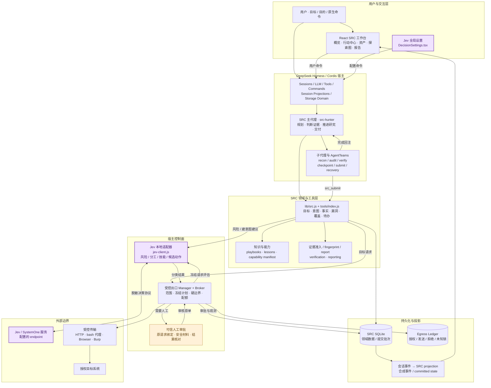
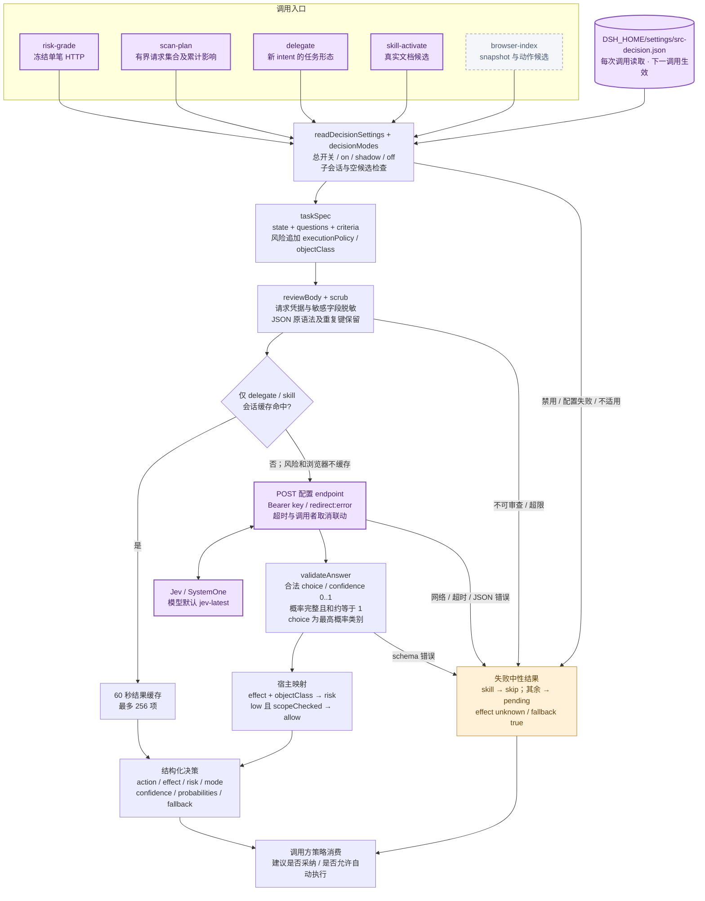
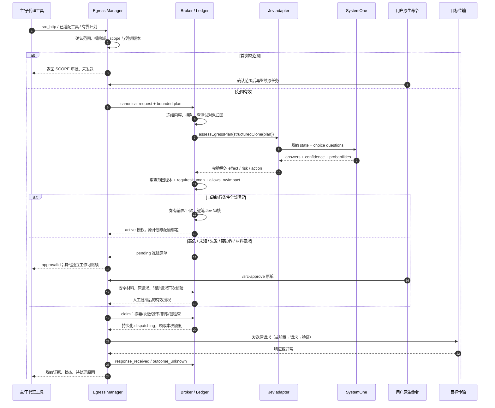
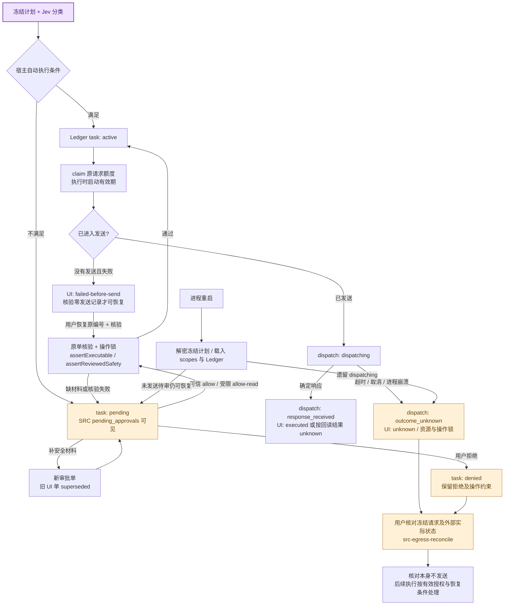
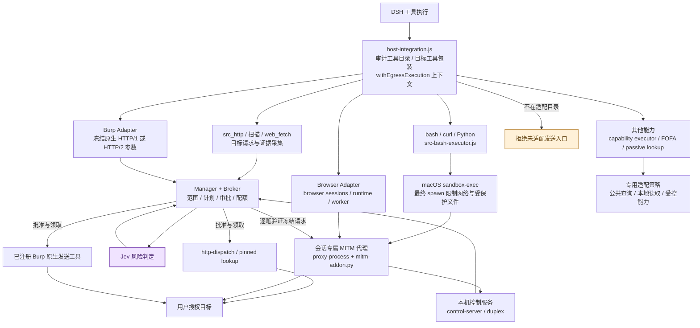
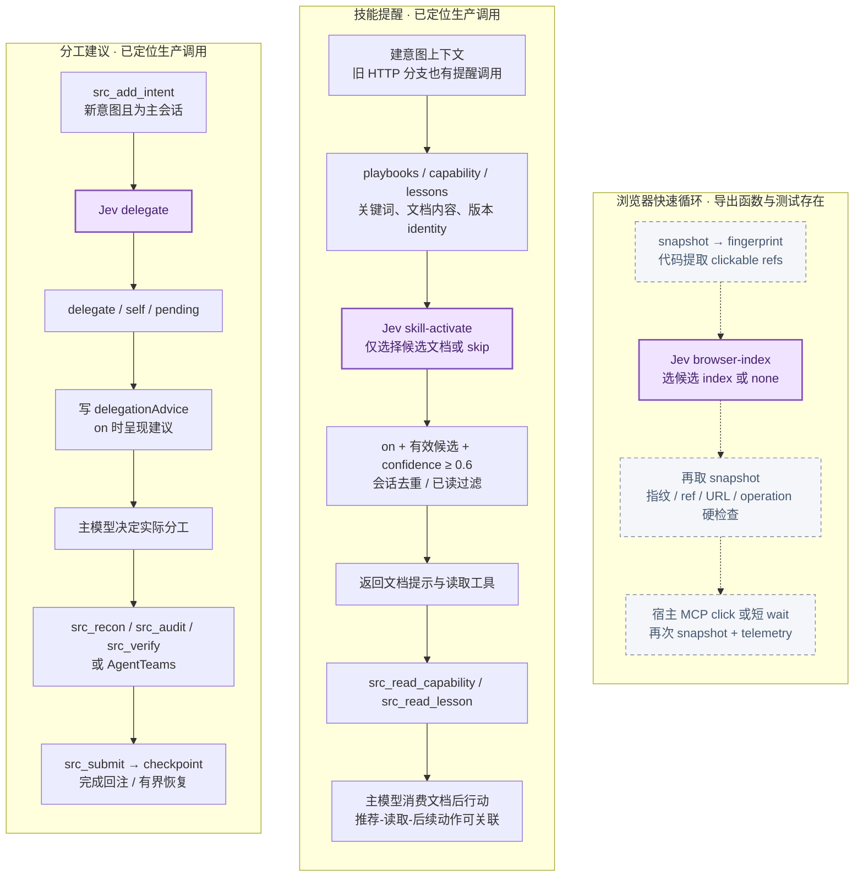
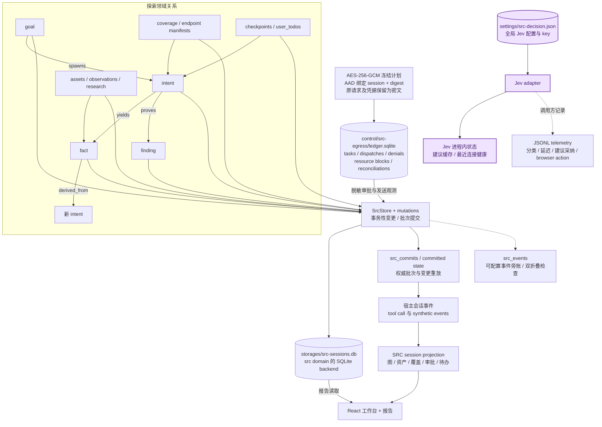

# DSH SRC 架构全景 — Jev 重点版

源码：0.1.0-local.124 / HEAD 7d55c48。分析日期：2026-10-07（Asia/Shanghai）。静态源码分析，未验证运行状态。

Jev 输出结构化分类或有限候选建议；宿主 Manager / Broker / Ledger 才决定实际执行。浏览器快速循环未定位生产接线。

## 01 · 全局架构

DSH 宿主、SRC 工作流、Jev 与目标执行之间的边界



实线表示已定位的调用或数据关系，连线聚合了同类调用。Jev 服务处于供应商边界；用户对目标的网络授权由宿主控制。浏览器候选动作模块的生产接线状态见第 06 图。

## 02 · Jev 内部架构

四项产品职责，对应五种 taskType；风险包括单笔与整批计划



单笔正文上限 65,536 字节，审查 state 上限 1 MiB；默认超时 120 秒，可配 1–300 秒。风险不使用跨请求缓存；无供应商自动重试或切换。confidence 用于审计，不是安全概率。图中“allow”仍须经过宿主硬边界与执行检查。

## 03 · 一笔请求如何经过 Jev

当前托管出口主路径；扫描计划复用 Broker，但整批评估一次



前置条件与回读并非因 GET/HEAD 就可信；自动及人工路径共用检查并可独立调用 Jev。扫描审批不逐笔重新调用模型，但出口逐笔匹配冻结清单、次数与速率。具体执行还会检查取消信号、会话生命周期及 scope 版本。

## 04 · 审批与恢复生命周期

流程示意；区分任务授权、单次发送、UI 执行状态



人工等待没有默认过期时间；有界执行期限从实际启动/发送开始。已发送而结果未知不会自动重放，也不宣称 exactly-once。allow-read 只适用于宿主允许的单笔未知影响确认入口，不能用自报 read/compute 覆盖 Jev 已判定高危。

## 05 · 目标流量执行边界

宿主工具包装、网络沙箱和各适配器共同约束实际发送



bash 网络约束当前明确仅支持 darwin，其他平台拒绝；不是跨平台能力承诺。Jev API、公共检索、目标流量属于不同用途，图中未把所有外部请求误画成同一目标审批。Burp 的范围/版本核对不等于控制 Burp 自身的 DNS 解析；手工 Burp 与未适配扩展行为不在该链路内。

## 06 · 分工、技能与浏览器三条链

实线为生产调用；虚线框表示已有实现但未发现生产入口接线



全仓调用检索只发现 browser-loop.js 导出与测试使用，未发现 lib/src、preset 或 UI 的生产调用点；实际浏览器出站适配已存在，但不能据此认定 Jev 快速循环已接入。托管 src_http 在 Manager 路径提前返回，不经过旧 HTTP 分支里的技能提醒。

## 07 · 领域数据、事件与 Jev 持久化

界面状态、执行授权与供应商配置分开存放



路径均相对 DSH_HOME，未读取本机运行配置或凭据。SQLite 领域数据与出口 Ledger 是两个存储边界；src_events 是可配置旁账，不能把它单独描述成全部业务状态的唯一来源。Telemetry 失败不阻塞执行。

## 08 · 安装与运行接线

npm bundle 通过 patch 与 preset 组合进宿主

```mermaid
flowchart LR
 PKG[package.json<br/>@lihua_dis/dsh-src<br/>0.1.0-local.124] --> PATCH[cordis.patch.yml]
 PKG --> EX[exports 子路径]
 PATCH --> UI[ui-src<br/>浏览器加载 client bundle]
 UI --> TS[src/dsh-client-ui-src<br/>React + @xyflow/react + tsdown]
 TS --> BUILD[lib/ui-src.client.js]
 PATCH --> SQLITE[storage-src-sqlite<br/>src domain 路由覆盖]
 PATCH --> DA[src-domain-admin<br/>域数据命令 + Jev 配置命令]:::jev
 PATCH --> EP[src-egress<br/>惰性 Manager 单例]
 PATCH --> BE[src-bash-executor<br/>替换原 bash-sandbox row]
 PATCH --> PR[preset-root<br/>注册包内预设根]
 PR --> PRE[src-hunter preset<br/>agent.cordis.yml]
 PRE --> SRC[src plugin<br/>工具、指令、投影、命令]
 PRE --> CHILD[src-subagent<br/>recon / audit / verify]
 SRC --> EP
 BE --> EP
 DA --> SET[Jev 全局配置<br/>相同 DSH_HOME 下共用]:::jev
 EX --> ENTRY[lib/index.js / lib/ui-src.js<br/>空 apply 占位入口]
classDef jev fill:#f0e3ff,stroke:#8551b9,stroke-width:2px,color:#45206d;
classDef human fill:#fff1d8,stroke:#b88436,color:#61410f;
classDef latent fill:#f4f6fa,stroke:#7c899b,stroke-dasharray:5 4,color:#485970;
```

本包是 DeepSeek Harness 插件 bundle，不是独立 Web 后端。业务逻辑主要在 lib/src.js 与 lib/src/；UI 可编辑源在 src/dsh-client-ui-src，lib/ui-src.client.js 为构建产物。图中的宿主服务来自 peer 依赖。

## 源码索引

- 安装组合：`cordis.patch.yml:24` — UI、SQLite 路由、域管理、preset、出口与 bash 执行器的组合入口。
- SRC 组合根：`lib/src.js:56` — 工具、领域 schema、命令与会话 projection；不是一个仅含工具的薄文件。
- 托管 HTTP 分支：`lib/src/tools/index.js:1837` — 有托管上下文即进入 Manager 并提前返回；后面才是旧策略路径。
- Jev 请求入口：`lib/src/decision/jev-client.js:43` — 调用适用性、配置、脱敏、缓存、请求、响应校验及分类映射。
- Jev 任务协议：`lib/src/decision/jev-client.js:21` — 五种 taskType 的 state、criteria 和判定说明。
- 供应商响应校验：`lib/src/decision/jev-client.js:33` — confidence、所有候选概率、概率和以及最大值一致性。
- 全局设置：`lib/src/decision/service-settings.js:7` — 默认 disabled；endpoint 为空；model=jev-latest；原子写入与文件权限。
- 用户设置命令：`lib/src/decision/service-commands.js:4` — status / save / test；recordInput:false，不注册为模型工具。
- 风险评估路由：`lib/src/egress/advisor.js:6` — 单笔走 risk-grade，多请求走 scan-plan。
- 批准策略：`lib/src/egress/decision-policy.js:6` — mode=on、low/allow 与请求方法、测试对象归属等联合检查。
- Broker：`lib/src/egress/broker.js:64` — 排队、范围重验、对象归属、Jev 评估、自动审批条件、冻结落账。
- 辅助请求审查：`lib/src/egress/broker.js:51` — 前置/回读逐笔审查；自动及人工执行共享。
- 出口协调器：`lib/src/egress/manager.js:23` — 范围、待审、会话代理、原生发送、操作锁、恢复与核对。
- Ledger：`lib/src/egress/ledger.js:6` — 独立 SQLite；事务领取；崩溃时把 dispatching 标为 outcome_unknown。
- 冻结密文：`lib/src/egress/frozen-plan.js:6` — AES-256-GCM；AAD 绑定会话和计划摘要。
- 安全材料：`lib/src/egress/safety-plan.js:44` — 读写语义、备份、前置和回读哈希、不可逆外发确认。
- 实际执行顺序：`lib/src/egress/safety-plan.js:86` — 前置条件→发送→回读；没有自动重放或补偿。
- 用户命令来源验证：`lib/src/egress/user-commands.js:6` — 要求真实 command/run 的 source.kind=user；模型执行上下文不可批准。
- 工具总边界：`lib/src/egress/host-integration.js:22` — 审计工具目录、MCP/Browser/Burp/能力适配与上下文包装。
- OS 网络约束：`lib/src/egress/executor.js:6` — darwin sandbox-exec；限制最终进程启动时网络。
- 旧 HTTP 策略：`lib/src/decision/http-policy.js:19` — 非托管分支仍在；off/shadow 使用旧规则，DELETE 等保留硬边界。
- 分工建议调用：`lib/src/tools/index.js:2232` — 新 intent 才评估；仅主会话；on 才写入建议。
- 知识候选：`lib/src/decision/knowledge-recall.js:34` — 遍历真实知识库和 lessons，按上下文词与文档版本构造候选。
- 技能去重：`lib/src/decision/skill-recall.js:92` — 推荐、读取、后续动作关联，进程内会话去重。
- 浏览器循环：`lib/src/decision/browser-loop.js:137` — 候选选择与硬检查已有实现；仓库内仅定位到测试调用。
- SRC 存储：`lib/src/store.js:24` — 领域写入、提交批次与恢复。
- 领域表定义：`lib/src.js:1542` — 目标、意图、事实、漏洞、资产、覆盖、研究、审批、待办等表。
- 事件旁账：`lib/src/event-store.js:9` — 事件幂等与可配置双折叠，不能替代现有 projection 契约。
- SQLite 后端：`lib/storage-sqlite.js:3` — node:sqlite 实现 storage-domain KV unit。
- Jev 设置 UI：`src/dsh-client-ui-src/src/client/DecisionSettings.tsx:16` — 全局连接配置与四项职责设置。
- 人工审批 UI：`src/dsh-client-ui-src/src/client/ActionCenter.tsx:121` — 待审、allow-read 与未发送恢复的交互。
- 最近生命周期修复：`docs/implementation/approval-lifecycle-audit-20261007.md:1` — local.124 文档；作为背景佐证，架构以当前源码为准。

## 使用与当前边界

- architecture.html 是单文件离线阅读版，内嵌全部 SVG；支持缩放、展开、下载 SVG、打印。
- 各 .mmd 为可编辑 Mermaid 源码，各 .svg 为独立矢量图。
- 托管 src_http 提前进入 Manager；旧 httpDecisionPolicy 不是它必经的下一站。
- Jev 失败不会自动转向 Laya；历史变量、字段和测试中仍可出现 Laya。
- 人工审批不会自动消除已发送请求的未知结果，核对本身不发送。
- Browser Adapter 已有生产代码；Jev browser-loop 仅定位到导出与测试调用。
- 本次只验证文档渲染及交互，没有连接 Jev 或目标，没有执行项目业务测试。
